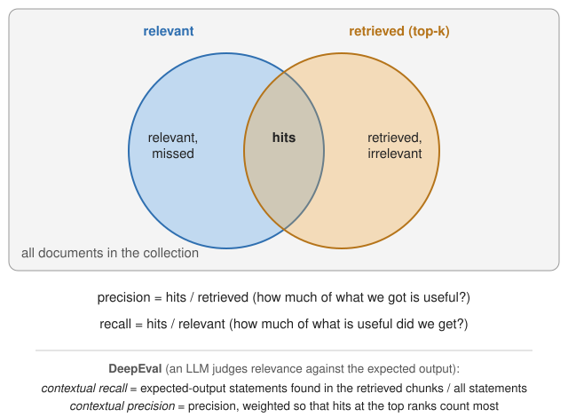

---
resources:
  - ../data/chunking_demo.json
toc-title: '{width=240px}<br> <h3>Embedding-based LLM-systems</h3>'
---

# Embedding-based LLM-systems

In the session on tool calling (@sec-functioncalling), we built a harness around the model that lets it act beyond generating text: the model requests a tool call, our code executes it and feeds the result back. One of the most useful tools is one that lets a model look up information it was never trained on, such as the documents on your hard drive.
In many tasks, we do not only want an LLM to generate text but to base the generation on an existing knowledge base.
Examples for these kinds of use cases include:

- Answering questions about a specific topic (e.g., a company or product)
- Summarizing a document
- Generating a report based on data

Though modern LLMs are increasingly capable of answering knowledge questions, the more complex a topic or the more important the factual basis of an answer, the more important it is to base generated answers on actual data.

## Semantic embeddings and vector stores

To let an LLM look up information, we need a tool that retrieves the information necessary for a task based on a request in natural language.
The basis for this are so-called *semantic embeddings*.
These are close to the concept we introduced when talking about the foundations of LLMs (see @sec-lmbasics) and can be understood as a way to map textual data into a vector space.
The main idea is that semantically similar texts should have similar embeddings, i.e., they are close in the vector space. Close in this context means a small distance or, equivalently, a high similarity. The usual measure is the **cosine similarity**, which has proven useful enough to be the default in a range of semantic retrieval implementations (e.g., it is used in [OpenAI tutorials](https://cookbook.openai.com/examples/recommendation_using_embeddings) and in [Azure AI Foundry embedding-applications](https://learn.microsoft.com/en-us/azure/ai-foundry/openai/concepts/understand-embeddings?view=foundry-classic&viewFallbackFrom=foundry)). The cosine similarity is defined as:

$$
\text{cosine\_similarity}(u, v) = \frac{u \cdot v}{\|u\| \|v\|} = \frac{\sum_{i=1}^{n} u_i v_i}{\sqrt{\sum_{i=1}^{n} u_i^2} \sqrt{\sum_{i=1}^{n} v_i^2}}
$$
The rationale here is that sequences with semantically similar contents should point to similar directions in the high dimensional vector space. See @fig-cosineSimilarity for an illustration of this and other common similarity concepts seen in semantic retrieval.


```{r}
#| label: fig-cosineSimilarity
#| fig-cap: Illustration of common similarity metrics in semantic search.
#| fig-subcap: 
#|    - Illustration of "semantic embeddings" of different word.
#|    - "Illustration of 4 common similarity concepts seen in semantic retrieval: cosine, euclidean, dot product and manhattan. Cosine similarity depends only on the angle between two vectors, the dot product on the angle and on both vectors' lengths. Euclidean and manhattan measure the distance between two points, as the straight line or as the sum of the absolute differences of the coordinates. Both distances are turned into similarities via 1/(1 + distance), and every panel is rescaled to the range 0 to 1, so colors are only comparable within a panel."
#| fig-alt: 
#| - Illustration of "semantic embeddings" of different word.
#|  The words "good", "nice", "orange", "bad" and "blue" are all mapped to a vector space.
#| - "Illustration of similarities between these words. 4 common similarity 
#| concepts seen in semantic retrieval: cosine, euclidean, dot product and manhattan."
#| echo: false
#| message: false
#| warning: false
#| fig-width: 8
#| fig-align: center
#| classes: .enlarge-onhover

library(tidyverse)

mat2df <- function(mat){
    tibble(row = rep(seq_len(nrow(mat)), times = ncol(mat)),
           col = rep(seq_len(ncol(mat)), each = nrow(mat)),
           value = as.vector(mat))
}

vectors  <- tibble(vector = letters[1:5],
                   words = c('good', 'nice', 'orange', 'bad', 'blue'),
                  x_end = c(.5, .23, -0.7,-0.25,.5),
                  y_end = c(.5, .26, .5, -0.24, -0.5),
                  y = 0,
                  x = 0)

Matrix <- as.matrix(vectors[3:4])
sim <- Matrix / sqrt(rowSums(Matrix * Matrix))
co_sim <- mat2df(sim %*% t(sim))

euclidean_sim <- mat2df(1 / (1 + as.matrix(dist(Matrix, method = 'euclidean'))))

manhattan_sim <- mat2df(1 / (1 + as.matrix(dist(Matrix, method = 'manhattan'))))

dot_product_sim <- mat2df(Matrix %*% t(Matrix))

similarities <- bind_rows(
    co_sim,
    euclidean_sim,
    manhattan_sim,
    dot_product_sim) %>%
    mutate(method = rep(c('cosine', 'euclidean', 'manhattan', 'dot product'),
           each = nrow(co_sim)),
           col = vectors$words[col],
           row = vectors$words[row])

vectors %>%
    ggplot(aes(color = words)) +
        geom_segment(aes(x=x,y=y,xend=x_end, yend = y_end), arrow = arrow(length = unit(.4, 'cm')), linewidth = 1) +
        scale_color_manual(values = c('good'='darkgreen', 'nice' = 'green', 'orange' = 'orange', 'bad' = 'red', 'blue' = 'darkblue'))+
        theme_minimal()

similarities %>% 
mutate(row = factor(row),
       col = factor(col, levels = rev(levels(row))))  %>% 
group_by(method)  %>% 
mutate(value = (value - min(value))/(max(value)-min(value))) %>%
    ggplot(aes(x = col, y = row)) +
    geom_tile(aes(fill = value)) +
    facet_wrap(~method) +
    labs(x = '', y = '') +
    theme_minimal() +
    #theme(legend.position = 'none') +
    scale_fill_distiller(palette = "Spectral", direction=-1)

```

As always, no single measure fits every problem, and the applicability of cosine similarity might not be optimal for your use case [@steckCosineSimilarityEmbeddingsReally2024; @goyalComparativeAnalysisDifferent2022].

Though one could use any kind of (L)LM to calculate embeddings for this case^[And there are approaches to use LLMs for this task, e.g., @jiangScalingSentenceEmbeddings2023a.], it is advisable to use models specifically trained for this purpose. 
@reimersSentenceBERTSentenceEmbeddings2019a proposed *Sentence-BERT* which is a simple but effective approach to calculate semantic embeddings. SBERT and similar approaches are based on a (L)LM that was trained to predict missing words as we discussed before, resulting in a general representation of natural language. In the case of the original paper, they used (among others) the BERT model [@devlinBERTPretrainingDeep2019a] mentioned before.

The authors then use this to embed a pair of sentences into one embedding-vector each^[BERT used the embedding of its special `[CLS]` token as a representation of the whole input. The SBERT paper compared this `[CLS]` token, mean pooling and max pooling over all token embeddings and settled on mean pooling.], for which some measure of semantic similarity is known. 
An example for a dataset containing such sentences is the [Stanford Natural Language Inference (SNLI) corpus](https://aclanthology.org/D15-1075/) [@bowmanLargeAnnotatedCorpus2015], which labels about 570k pairs of sentences as either *entailment*, *contradiction* or *neutral*.
@reimersSentenceBERTSentenceEmbeddings2019a then concatenated the two sentence embeddings $u$ and $v$ with their absolute element-wise difference $|u - v|$ into a single vector, which is fed to a classifier that predicts the relationship of the two sentences. At inference, this classification head is removed and replaced by the cosine similarity discussed above.
The resulting network is highly effective in calculating semantic similarities between sentences.

A look at the [sbert-website](https://www.sbert.net/docs/sentence_transformer/loss_overview.html) shows that the library has grown and now supplies a series of learning paradigms that can be used to efficiently tune a model for your specific use case^[And this does not have to be expensive. @tunstallEfficientFewShotLearning2022 have shown a contrastive fine-tuning approach (SetFit) that reaches competitive accuracy with only a handful of labeled examples per class.]. 
As the library has grown, so has the sheer amount of pretrained embedding-models in some way based on this architecture that are hosted on huggingface. The [MTEB-Leaderboard](https://huggingface.co/spaces/mteb/leaderboard) is a good start to search for a model for your application.
One important use of this model family is the semantic search for documents.
If a model is very good at finding similar sentences, it can also be very good to find documents that are very similar to a question.

Look at the example illustrated in @fig-docRetrieval. The question "why is the sky blue" is embedded with the same model as our 5 documents stating some facts.

{#fig-docRetrieval .enlarge-onhover}

We can then calculate the cosine-similarity between these embeddings and return the document, that has the highest similarity to our question.


:::{.callout-note}

### 📝 Task

Install the necessary packages (`uv add sentence-transformers datasets scikit-learn`) and download [the climate_fever-dataset](https://huggingface.co/datasets/tdiggelm/climate_fever).

Choose one model from the [MTEB-Leaderboard](https://huggingface.co/spaces/mteb/leaderboard) that you deem adequately sized and appropriate for the task

Test the different metrics shown in @fig-cosineSimilarity for the first twenty claims of the dataset and a question you formulate.

Use the similarity-implementations from [sklearn.metrics.pairwise](https://scikit-learn.org/dev/api/sklearn.metrics.html#module-sklearn.metrics.pairwise).

:::

This approach of using a model to embed documents and questions into a vector space is the basis for the so-called *Retrieval augmented generation*.

## Retrieval augmented generation

Retrieval augmented generation (RAG) is a framework that does pretty much what it says on the tin.
You use a retrieval model to find documents that are similar to your question and then either return these documents or feed them into a generative model, which then generates an answer based on these documents.
This process can also be wrapped as a tool (see @sec-functioncalling), so that the LLM itself requests a lookup when it needs one.

Retrieval does not have to be semantic. All kinds of data sources and databases can be made accessible to an LLM, but we will focus on embedding-based retrieval here.

Although the small example in the last task was working, it is not really scalable. Comparing a question with every single document is fine for a limited set of examples, but to make a whole knowledge base searchable, you need an appropriate database system.

### Vector databases

A vector database is a database that stores vectors and allows for efficient similarity searches. Efficient here means that the database does not compare a query with every stored vector. Instead, it builds an index for *approximate nearest neighbor* search. Qdrant, for example, uses a graph-based index (HNSW, Hierarchical Navigable Small World) in which each vector is linked to a few similar vectors, so a search only has to follow a short path through the graph. The result is not guaranteed to be the exact top-k, but it is very close and orders of magnitude faster on large collections.
As can be seen in the [db-engines ranking](https://db-engines.com/en/ranking) there has been a surge of interest in this area recently, with many new players entering the market.
From the plethora of vector databases, these three deserve an honorable mention:

1. [Chroma](https://www.trychroma.com/): an open-source database that is especially easy to get running, either in memory, on disk or as a server.

2. [Elasticsearch](https://www.elastic.co/guide/en/elasticsearch/reference/current/bring-your-own-vectors.html): a well established database that is the go to system for open source search engines and has recently (and kind of naturally) also branched out into vector databases.

3. [Qdrant](https://qdrant.tech/): the product of a Berlin-based startup that focusses on stability and scalability. It can also run in memory, but does natively support hard drive storage.

For production, Qdrant is usually run as a server via [docker](https://qdrant.tech/documentation/quickstart/) and accessed with the Python client. For experiments, the client can also run Qdrant in-process (`QdrantClient(":memory:")` or a local path), which is all we need in class.

::: {.callout-note}

#### 📝 Task

Install the Qdrant Python client (`uv add qdrant-client`).

Create a collection for the claims and one for the evidence in [the climate_fever-dataset](https://huggingface.co/datasets/tdiggelm/climate_fever).
Add the first 200 entries to each of these collections. Use sentence_transformers to do this, [here](https://qdrant.tech/documentation/beginner-tutorials/search-beginners/) is a tutorial by qdrant that leads you through the process.

Test the similarity search on a question you formulate.

:::

### RAG

The last step to make this into a RAG pipeline is to use a generative model to answer the question based on the retrieved documents.

This means that we collect the relevant documents like we did before, still based on a natural language question, but instead of returning the hits we got from the index, we feed them into an LLM and ask it to generate an answer based on these documents. This is where the name retrieval augmented generation comes from: we use the retrieval step to augment the generative model with additional information. The diagram in @fig-rag illustrates this process.

{#fig-rag .enlarge-onhover}

The retrieved documents simply become part of the prompt. A minimal template could look like this, with an ID per snippet so that the model can reference its sources:

```python
# hits: the result of your Qdrant search, question: the user's question
snippets = "\n".join(f"[{i}] {hit.payload['text']}" for i, hit in enumerate(hits, start=1))
prompt = f"""Answer the question using only the numbered snippets below.
Cite the snippets you use as [1], [2], ... If they do not contain the answer, say so.

Snippets:
{snippets}

Question: {question}"""
```

::: {.callout-note}

#### 📝 Task

Implement a RAG pipeline for the climate_fever dataset using Qdrant as vector database and an LLM of your choice for answer generation.

Try to find a prompt that results in the LLM

a) using the information given 
b) not inventing new information
c) referencing the source of the information it uses


Upload your results until here (embedder, database and answer generation) to moodle. All following tasks are optional.
:::


Most LLM frameworks, such as LlamaIndex or LangChain, provide integrations for a variety of vector databases.

Others, like Google's Agent Development Kit (ADK), which we will use from the session on agents onwards, skip the wrappers: the retrieval stays plain Qdrant code, and the agent just gets it as a tool.
See @tip-adkRag for an example RAG-system implemented with ADK.

:::{#tip-adkRag .callout-tip collapse="true" appearance="minimal"}



:::


### Document chunking

The examples we looked at until now were all working with short text snippets that comfortably fit into the context window of an LLM.
If you think about usual use cases for RAG systems, this is not the most common case though.
Usually, you will have a base of documents that can span several thousand tokens and you want to be able to answer questions about these documents.
Furthermore, you do not only want to know which document might be relevant, but ideally also which part of the document matches your question best. There is also a technical reason: embedding models have a maximum input length, often 256 to 512 tokens for SBERT-style models, and silently truncate everything beyond it. A whole document embedded as one vector would therefore often only represent its beginning, and even with a long-context model, one vector would average over all topics of the document.

This is where the process of document chunking or document splitting comes into play.
The most common, so-called **naive chunking** methods ignore the content of the document: they either cut at structural boundaries such as sentences, paragraphs or pages, or into windows of a fixed size, measured in tokens or sentences. The resulting chunks are individually embedded and stored in the vector database.
To prevent loss of relevant context at the cut points, it is additionally common to add some **overlap** between the chunks. This mitigates the lost context problem, but creates redundancies in the data.

An alternative is **semantic chunking**, which places the cuts based on the meaning of the text. The [LlamaIndex documentation](https://developers.llamaindex.ai/python/examples/node_parsers/semantic_chunking/) describes a popular variant: the splitter compares the embeddings of neighboring sentences and starts a new chunk where their similarity drops, with the threshold set as a percentile of all neighbor distances.

@quSemanticChunkingWorth2025 compared this breakpoint approach and a second semantic chunker against fixed-size chunking. The **breakpoint-based** chunker walks through the document and starts a new chunk wherever the cosine distance between two neighboring sentences exceeds a threshold, which is usually set relative to all distances in the document, for example as a percentile. The **clustering-based** chunker clusters all sentences at once instead. Its distance mixes the semantic distance of two sentences with their distance in the document, weighted by a parameter λ, so a chunk can also collect sentences that are far apart. The result of the comparison is sobering: across document retrieval, evidence retrieval and answer generation, neither semantic chunker consistently beat the fixed-size baseline, which makes the additional compute hard to justify.

A third option keeps the naive boundaries but changes how the chunks are embedded. In *late chunking* [@guntherLateChunkingContextual2024; @LateChunkingLongContext2024], the whole document is first run once through a long-context embedding model, and the resulting token embeddings are only then averaged per chunk. Each chunk embedding thereby carries information about the context of the whole document, without any change to the chunk boundaries.
<!-- Haystack does not implement this feature yet, though [it is planned](https://github.com/deepset-ai/haystack/issues/8111). -->

The interactive illustration below applies all three strategies to the introduction of their paper. The colors mark the four paragraphs of the introduction, so a chunk with a single color stays within one paragraph.

```{ojs}
//| echo: false
//| output: false
demo = FileAttachment("../data/chunking_demo.json").json()
sents = demo.sentences
n = sents.length
S = demo.similarity
topics = [...new Set(sents.map(d => d.topic))]
color = new Map(topics.map((t, i) => [t, ["#7c3aed", "#059669", "#d97706", "#dc2626", "#2563eb", "#64748b"][i % 6]]))
gaps = d3.range(n - 1).map(i => 1 - S[i][i + 1])
dist = (a, b, lam) => Math.max(lam * Math.abs(a - b) / n + (1 - lam) * (1 - Math.max(S[a][b], 0)), 0)

function fixedChunks(size, overlap) {
  const out = [];
  for (let s = 0; s < Math.max(n - overlap, 1); s += size - overlap) out.push(d3.range(s, Math.min(s + size, n)));
  return out;
}

function splitAt(breaks) {
  const edges = [0, ...breaks.map(b => b + 1), n];
  return d3.pairs(edges).filter(([a, b]) => b > a).map(([a, b]) => d3.range(a, b));
}

// single linkage with a distance threshold = connected components of all pairs closer than the threshold
function clusterChunks(lam, t) {
  const parent = d3.range(n), find = i => parent[i] === i ? i : (parent[i] = find(parent[i]));
  for (let a = 0; a < n; a++) for (let b = a + 1; b < n; b++) if (dist(a, b, lam) < t) parent[find(a)] = find(b);
  return d3.groups(d3.range(n), find).map(([, m]) => m).sort((x, y) => x[0] - y[0]);
}

function chunkView(chunks) {
  const purity = d3.mean(chunks, c => d3.max(d3.rollup(c, v => v.length, i => sents[i].topic).values()) / c.length);
  return htl.html`<div>
    <div class="cd-stats">
      <span><b>${chunks.length}</b>chunks</span>
      <span><b>${Math.round(100 * purity)}%</b>purity</span>
      <span><b>${d3.mean(chunks, c => c.length).toFixed(1)}</b>sentences/chunk</span>
    </div>
    ${chunks.map((c, k) => htl.html`<div class="cd-chunk"><div class="cd-chunk-head">chunk ${k + 1}</div>
      ${c.map(i => htl.html`<div class="cd-sent" style=${`--c:${color.get(sents[i].topic)}`} title=${sents[i].sentence}>
        <span class="cd-idx">${i}</span>${sents[i].sentence}</div>`)}</div>`)}
  </div>`;
}
```

<details class="cd-details">
<summary><span>Interactive illustration: fixed-size vs. semantic chunking</span><span class="cd-hint"></span></summary>

```{ojs}
//| echo: false
htl.html`<div class="cd-legend">${topics.map(t => htl.html`<span style=${`--c:${color.get(t)}`}>${t}</span>`)}</div>`
```

:::: {.cd-grid}

::: {.cd-card}
<div class="cd-title">Fixed-size <span class="cd-badge base">baseline</span></div>
<div class="cd-desc">Cuts every n sentences, blind to their content. Overlap repeats sentences in neighboring chunks to keep some context.</div>

```{ojs}
//| echo: false
viewof size = Inputs.range([2, 8], {step: 1, value: 3, label: "Chunk size"})
viewof overlap = Inputs.range([0, size - 1], {step: 1, value: 0, label: "Overlap"})
chunkView(fixedChunks(size, overlap))
```
:::

::: {.cd-card}
<div class="cd-title">Breakpoint-based <span class="cd-badge">semantic</span></div>
<div class="cd-desc">Cuts wherever two neighboring sentences are further apart than the threshold (red bars), set either as a percentile of all distances or as an absolute cosine distance. Only ever compares two sentences at a time.</div>

```{ojs}
//| echo: false
viewof mode = Inputs.radio(["percentile", "absolute"], {value: "percentile", label: "Threshold"})
viewof q = mode === "percentile"
  ? Inputs.range([50, 99], {step: 1, value: 80, label: "Percentile"})
  : Inputs.range([0, 1], {step: 0.01, value: +d3.median(gaps).toFixed(2), label: "Distance"})
thr = mode === "percentile" ? d3.quantile(gaps, q / 100) : q
chunkView(splitAt(d3.range(n - 1).filter(i => gaps[i] > thr)))
htl.html`<div class="cd-plot">${Plot.plot({
  width: 330, height: 170, marginLeft: 40, marginBottom: 45, style: {background: "transparent", fontSize: "10px"},
  x: {label: "between sentences", tickFormat: i => `${i}|${i + 1}`, tickRotate: -45},
  y: {label: "cos. distance", grid: true},
  marks: [
    Plot.barY(gaps.map((g, i) => ({i, g})), {x: "i", y: "g", fill: d => d.g > thr ? "#dc2626" : "#cbd5e1"}),
    Plot.ruleY([thr], {stroke: "#dc2626", strokeDasharray: "4,3"})
  ]})}</div>`
```
:::

::: {.cd-card}
<div class="cd-title">Clustering-based <span class="cd-badge">semantic</span></div>
<div class="cd-desc">Links all sentence pairs closer than the threshold (white dots) and makes each connected group a chunk, even across the document. λ mixes position (1) and meaning (0).</div>

```{ojs}
//| echo: false
viewof lam = Inputs.range([0, 1], {step: 0.05, value: 0.2, label: "λ"})
viewof t = Inputs.range([0.05, 0.6], {step: 0.01, value: 0.3, label: "Threshold"})
chunkView(clusterChunks(lam, t))
pairs = d3.cross(d3.range(n), d3.range(n)).map(([a, b]) => ({a, b, d: dist(a, b, lam)}))
htl.html`<div class="cd-plot">${Plot.plot({
  height: 250, width: 250, padding: 0, marginLeft: 25, marginBottom: 25, style: {background: "transparent", fontSize: "10px"},
  x: {label: null}, y: {label: null}, color: {scheme: "purples", reverse: true},
  marks: [
    Plot.cell(pairs, {x: "a", y: "b", fill: "d", title: p => `${p.a}–${p.b}: ${p.d.toFixed(2)}`}),
    Plot.dot(pairs.filter(p => p.a !== p.b && p.d < t), {x: "a", y: "b", r: 2.5, fill: "white"})
  ]})}</div>`
```
:::

::::

</details>

Purity is the share of the most frequent paragraph per chunk, averaged over all chunks. Note that purity rewards small chunks (a single sentence is always pure), so compare settings with a similar number of sentences per chunk. The sentence embeddings were computed once with a small embedding model, everything else runs in your browser.

Playing with the sliders shows that the semantic chunkers can produce cleaner chunks than the fixed-size baseline. Whether this matters for retrieval is a different question. @fig-quResults shows the document-retrieval results of @quSemanticChunkingWorth2025 as the gain of each semantic chunker over fixed-size chunking. The large gains appear only on the *stitched* datasets, which the authors built by concatenating short documents on unrelated topics, a situation in which topic shifts are easy to detect. Even there, only the breakpoint chunker gains substantially, and only on two of six datasets. On the datasets with real, coherent documents, fixed-size chunking is as good or better.

::: {#fig-quResults}

```{ojs}
//| echo: false
quTable = [
  ["Miracl", true, 69.45, 81.89, 67.35], ["NQ", true, 43.79, 63.93, 41.01], ["Scidocs", true, 16.82, 17.60, 19.87],
  ["Scifact", true, 35.27, 36.27, 35.70], ["BioASQ", true, 61.86, 61.87, 62.49], ["NFCorpus", true, 21.36, 21.07, 22.12],
  ["HotpotQA", false, 90.59, 87.37, 84.79], ["MSMARCO", false, 93.58, 92.23, 93.18],
  ["ConditionalQA", false, 68.11, 64.44, 65.94], ["Qasper", false, 90.99, 89.27, 90.77]
].flatMap(([name, stitched, fixed, bp, cl]) => [
  {dataset: stitched ? `${name}*` : name, chunker: "breakpoint", gain: bp - fixed},
  {dataset: stitched ? `${name}*` : name, chunker: "clustering", gain: cl - fixed}
])
Plot.plot({
  width: 700, height: 330, marginLeft: 100, marginBottom: 45, style: {fontSize: "12px", background: "transparent"},
  x: {label: "F1@5 gain over fixed-size chunking (percentage points) →", labelAnchor: "center", labelOffset: 38, grid: true},
  y: {label: null, domain: [...new Set(quTable.map(d => d.dataset))]},
  color: {domain: ["breakpoint", "clustering"], range: ["#dc2626", "#7c3aed"], legend: true},
  marks: [
    Plot.ruleX([0], {stroke: "#475569"}),
    Plot.ruleY(["HotpotQA"], {stroke: "#94a3b8", strokeDasharray: "4,3", dy: -13}),
    Plot.text(["stitched documents ↑", "real documents ↓"], {x: 21, y: ["NFCorpus*", "HotpotQA"], dy: [4, -4], textAnchor: "end", fill: "#64748b"}),
    Plot.ruleY(quTable, Plot.groupY({x1: "min", x2: "max"}, {y: "dataset", x: "gain", stroke: "#cbd5e1"})),
    Plot.dot(quTable, {x: "gain", y: "dataset", fill: "chunker", r: 5, title: d => `${d.chunker}: ${d.gain.toFixed(2)}`})
  ]
})
```

Document retrieval (F1@5) of the two semantic chunkers relative to fixed-size chunking, redrawn from Table 1 of @quSemanticChunkingWorth2025 (CC BY 4.0). Datasets marked with * are stitched: artificially concatenated short documents on different topics.
:::

::: {.callout-note}

#### 📝 Task

Implement a document chunking strategy for a book of your choice from the [project_gutenberg](https://huggingface.co/datasets/manu/project_gutenberg) dataset.

You can use any approach you like, but you should explain your choice and why it is appropriate for this dataset.

:::

### Query Expansion/Transformation

Until now, we have based our retrieval on the assumption, that the question the user formulates is a good representation of their information need.
This is not always the case though.
Often, users do not know what they are looking for or they use synonyms or paraphrases that are not present in the documents.
If the question is formulated poorly or uses different words than the documents, the system might not find the relevant documents.
**Query expansion** addresses this by enriching the original question with paraphrases, synonyms or related terms, so that documents phrased differently from the question are also found. The simplest implementation asks an LLM for several alternative formulations of the question, runs all of them against the index and merges the results. Without an LLM, keywords extracted from the question can be used in the same way.

A more refined approach are *Hypothetical Document Embeddings* (HyDE) [@gaoPreciseZeroShotDense2023]. Instead of reformulating the question, an LLM writes a hypothetical document that answers it, and this document is used to query the index. The idea behind this is that an answer resembles other answers more than a question does, so the hypothetical document lands closer to the relevant documents in embedding space. Factual errors in the generated document matter little, since it is only used for the search and never shown to the user. Going one step further, *multi-step query transformations* first run a (complex) query against the index and use the answer to formulate follow-up questions, which are then executed against the index in turn.

::: {.callout-note}

#### 📝 Task

Implement query expansion for the climate_fever dataset. Use the `openai` client from @sec-prompting to let an LLM either generate alternative formulations of the query or a hypothetical answer document (HyDE), and use its output to query your index.

Experiment with different prompts and temperatures.

:::

::::{.callout-tip collapse="true" appearance="minimal"}
## HyDE as an ADK workflow

In the workflow at the end of @tip-adkRag, HyDE is just one more agent in front of the retrieval step: the agent writes the hypothetical document, and the retrieval function searches with it instead of with the question. Since the summarizer should still answer the original question, a first function node stores it in `ctx.state`, the workflow's shared memory. The code reuses `model`, `ask`, `find_references` and `summarizer` from @tip-adkRag:

```python
from google.adk import Agent, Workflow

def store_question(node_input: str, ctx):
    ctx.state["question"] = node_input
    return node_input

hyde_writer = Agent(
    name="hyde_writer",
    model=model("qwen3:4b"),
    instruction="Write a short passage, as it could appear in a scientific paper, "
                "that answers the question. Output only the passage.",
)

def retrieve(node_input: str, ctx) -> str:
    # node_input is the hypothetical passage: search with it, but answer the original question
    return f"Question: {ctx.state['question']}\n\nSnippets:\n{find_references(node_input)}"

hyde_rag = Workflow(
    name="hyde_rag",
    edges=[("START", store_question, hyde_writer, retrieve, summarizer)],
)

print(await ask(hyde_rag, "What is the meaning of Query, Key and Value in the context of self-attention?"))
```

We will look at `ctx.state` and more complex workflow graphs in @sec-orchestration.
::::

### Hybrid Search

Up to here, we have focused exclusively on semantic search using vector embeddings. However, purely semantic approaches can sometimes miss documents that contain exact keyword matches or specific terminology that users explicitly mention in their queries. This is where **hybrid search** becomes valuable by combining multiple retrieval strategies.

Hybrid search combines semantic search with traditional keyword-based methods to leverage the strengths of both. The classic keyword method is BM25, which scores a document by how often the query terms occur in it, weighted by how rare these terms are in the whole collection. Semantic search excels at finding conceptually related documents, while keyword search ensures that exact matches of names, numbers or technical terms are not missed.

Qdrant supports hybrid search through its [query API](https://qdrant.tech/documentation/concepts/hybrid-queries/). A dense vector search and a sparse vector search (for example with BM25 vectors) are executed in parallel as so-called prefetches, and their result lists are fused. Qdrant offers Reciprocal Rank Fusion (RRF), which combines the ranks of a document in both lists, and Distribution-Based Score Fusion (DBSF), which combines their normalized scores. The fused list can optionally be re-ranked by a more expensive model, for example a cross-encoder that reads query and document together, or a late-interaction model like ColBERT [@santhanamColBERTv2EffectiveEfficient2022]. Which mix works best depends on the queries: conceptual questions profit from the dense part, queries with specific technical terms or proper nouns from the sparse part.

::: {.callout-note}

#### 📝 Task

Extend your climate_fever RAG system to use hybrid search combining semantic and keyword-based retrieval in Qdrant (you can find a tutorial on how to implement this [here](https://qdrant.tech/documentation/advanced-tutorials/reranking-hybrid-search/)).

Compare the retrieval results of pure semantic search versus hybrid search on at least 5 different test queries. Pay attention to cases where one approach significantly outperforms the other.

Document your findings: When does hybrid search provide better results? When is pure semantic search sufficient?

:::

### RAG Evaluation

Building a RAG system is one thing, knowing whether it works well is another. Since a RAG system consists of a retriever and a generator, it can fail in two places: the retriever can miss the relevant documents, or the generator can ignore, misread or embellish what it was given. A useful evaluation therefore looks at both components separately before judging the final answers.

#### Evaluating the retriever

The retriever can be evaluated like any search engine, as long as we know which documents would have been relevant for a query. For each query, precision and recall compare two sets: the documents the retriever returned and the documents that are relevant (@fig-retrievalVenn). Precision is the share of retrieved documents that are relevant, $\text{precision} = |\text{relevant} \cap \text{retrieved}| \,/\, |\text{retrieved}|$, recall the share of relevant documents that were retrieved, $\text{recall} = |\text{relevant} \cap \text{retrieved}| \,/\, |\text{relevant}|$. Both are usually reported for a fixed number $k$ of retrieved documents (precision@k and recall@k), and they pull in opposite directions: retrieving more chunks can never decrease recall, but usually decreases precision. Since the generator reads the retrieved chunks in order, the rank of the first relevant hit matters as well. The *mean reciprocal rank* (MRR) averages $1/\text{rank}$ of the first relevant document over all queries, so an MRR of 1 means that the first hit was always relevant.

{#fig-retrievalVenn .enlarge-onhover}

These metrics need no LLM and are cheap, exact and reproducible, but they need relevance labels. climate_fever comes with such labels: every claim is accompanied by five evidence sentences from Wikipedia that annotators judged against it, which gives us a ready-made set of relevant documents per claim.

::: {.callout-note}

#### 📝 Task

Evaluate the retriever of your climate_fever RAG system. Use the claims as queries and treat the evidence sentences annotated for a claim as its relevant documents. You can additionally exclude evidence sentences whose `evidence_label` marks them as not containing enough information (see the dataset card for the label names). Make sure that your evidence collection contains the evidence of all claims you use as queries.

Compute precision@k, recall@k and MRR over at least 50 claims for k = 1, 3, 5 and 10, and compare two configurations, for example two embedding models or your semantic and your hybrid search.

:::

#### Evaluating with an LLM as a judge

Relevance labels like those of climate_fever rarely exist for your own documents. An alternative is to let a second LLM judge the outputs of the system, an idea we will discuss in more depth in the section on LLMs as judges (@sec-llmjudge). [DeepEval](https://deepeval.com/guides/guides-rag-evaluation) implements such judge-based metrics for both components of a RAG system. For the retriever, *contextual relevancy* lets the judge extract the statements in the retrieved chunks and reports the share of statements that are relevant to the query. *Contextual precision* checks whether the relevant chunks are ranked above the irrelevant ones, and *contextual recall* checks which statements of an expected answer can be attributed to the retrieved chunks. For the generator, *faithfulness* reports the share of claims in the answer that do not contradict the retrieved chunks, and *answer relevancy* the share of statements in the answer that address the query. Contextual relevancy, faithfulness and answer relevancy need no reference answer and can be computed for any query, whereas contextual precision and recall need an expected output to compare against (@fig-deepevalMetrics). The judge does not have to be a commercial model, since the metrics accept custom model classes. [RAGAS](https://docs.ragas.io/) is a widely used alternative that implements comparable metrics.

```{mermaid}
%%| label: fig-deepevalMetrics
%%| fig-cap: "What DeepEval's RAG metrics compare. Solid arrows are the RAG pipeline, dotted arrows are the comparisons an LLM judge makes. Only the two metrics pointing to the expected output need a reference answer."
flowchart LR
    Q[Query] --> R[Retriever]
    R --> C[Retrieved chunks]
    C --> L[LLM]
    L --> A[Answer]
    E[Expected output]
    C -.->|"Contextual Relevancy: relevant to the query?"| Q
    C -.->|"Contextual Precision: relevant chunks ranked first?"| E
    C -.->|"Contextual Recall: expected statements retrieved?"| E
    A -.->|"Faithfulness: consistent with the chunks?"| C
    A -.->|"Answer Relevancy: addresses the query?"| Q
```

#### Claim-level diagnosis with RAGChecker

[RAGChecker](https://github.com/amazon-science/RAGChecker) [@ruRAGCheckerFinegrainedFramework2024] goes one step further and evaluates on the level of individual claims. An LLM first splits the ground-truth answer and the response into claims, and a second LLM call checks which of these claims are entailed by the ground truth, the response or the retrieved chunks. This needs a ground-truth answer per query, but no further annotation. The resulting metrics can be read off a Venn diagram of three sets of claims (@fig-ragcheckerVenn). Overall precision is the share of response claims that are correct, overall recall the share of ground-truth claims that the response contains. For the retriever, *claim recall* is the share of ground-truth claims found in the retrieved chunks, and *context precision* the share of retrieved chunks that contain at least one of them. For the generator, *hallucination* counts incorrect response claims that no chunk supports, *noise sensitivity* incorrect claims that the generator took over from the chunks, *self-knowledge* correct claims that stem from the model rather than from the chunks, and *context utilization* the share of retrieved ground-truth claims that made it into the response. The context circle thereby tells us *why* something went wrong: missing information that was retrieved but not used points to the generator, missing information that was never retrieved points to the retriever.

{#fig-ragcheckerVenn .enlarge-onhover}

#### Choosing an approach

The three approaches differ less in whether they use an LLM than in what they need as input. Classic retrieval metrics need relevance labels per query, but no LLM. RAGChecker needs a ground-truth answer per query and uses LLM calls to extract and check claims, which in turn yields a fine-grained diagnosis of both components. DeepEval's referenceless metrics need neither and can therefore be applied to any domain, at the price of depending entirely on the judge. Everything that relies on an LLM judge shares two concerns: the judge can be wrong itself, so its verdicts should be spot-checked against human judgment, and judging many queries with a large model is slow and costly. A pragmatic strategy is to build a small labeled test set for your own documents early, to evaluate the retriever with classic metrics on it, and to add judge-based metrics for the generator.

#### Summary

Taken together, a RAG system is a pipeline of decisions that can each be evaluated and tuned separately: how documents are chunked, which model embeds them, how the vector database indexes them, whether queries are expanded, whether keyword and semantic search are combined and re-ranked, how the retrieved chunks are put into the prompt, and finally how the result is evaluated. The tasks of this chapter walk through these steps in the same order, so your climate_fever system can serve as a test bed for each of them.


## Further Readings

* [This blogpost](https://www.deepset.ai/blog/llms-retrieval-augmentation) by DeepSet gives a good overview of the concept of RAG

* [This blogpost](https://qdrant.tech/articles/what-is-a-vector-database/) by qdrant about (their) vector store and its inner workings

* [Qdrant's Hybrid Search Documentation](https://qdrant.tech/documentation/concepts/hybrid-queries/) provides detailed information on combining multiple search strategies

* [DeepEval's RAG Evaluation Guide](https://deepeval.com/guides/guides-rag-evaluation) offers practical approaches to measuring RAG system performance

## References