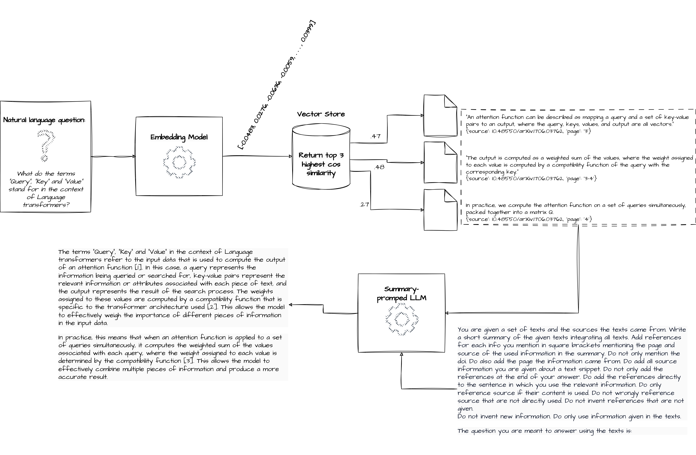
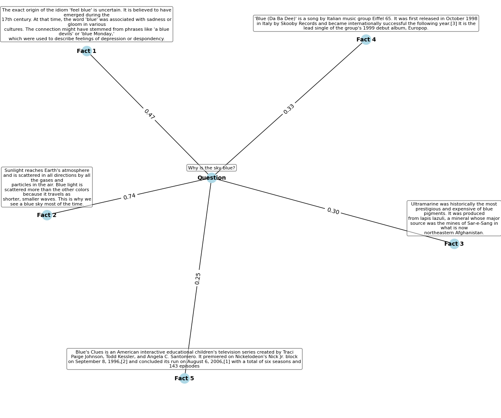
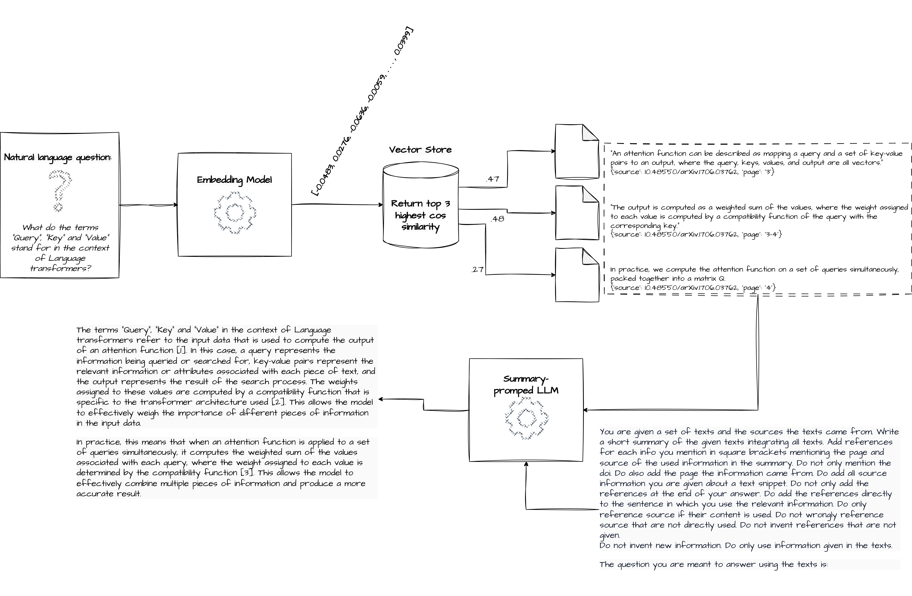
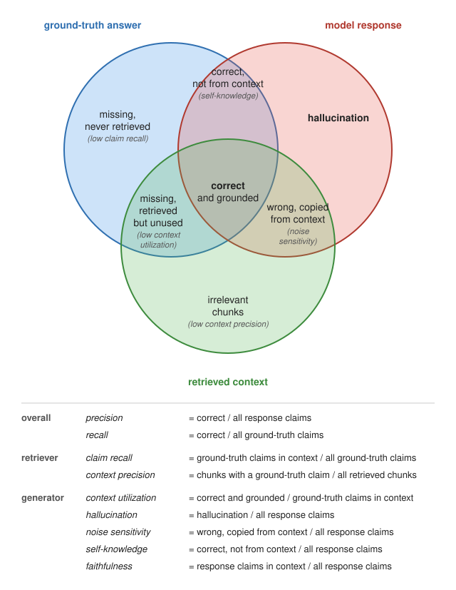

---
resources:
  - ../data/chunking_demo.json
toc-title: '{width=240px}<br> <h3>Embedding-based LLM-systems</h3>'
---

# Embedding-based LLM-systems

All agents (and all LLM-pipelines if sufficiently complex) we discussed until here are using tools that allow them to use their generated inputs in some way.
In most of the task we want to utilize LLMs, we do not only want to generate text but to also inform the generation based on some kind of existing knowledge base.
Examples for these kinds of usecases include:

- Answering questions about a specific topic (e.g., a company or product)
- Summarizing a document
- Generating a report based on data

Though most modern LLMs are increasingly capable in answering basic knowledge-questions, the more complex a topic or the more relevant the factual basis of an answer is, the more it is important to base generated answers on actual data.

## Semantic embeddings and vector stores

To empower a LLM too look up information during its thought-process, one has to build a tool that allows a LLM to use natural language to retrieve information necessary for a task.
The fundamental principle to do this are so-called *semantic embeddings*.
These are pretty close to the concept we introduced when talking about the foundations of LLMs (see [here](getting_started_with_llms)) and can be understood as a way to map textual data into a vector space.
The main idea is that semantically similar texts should have similar embeddings, i.e., they are close in the vector space. Close in this context is meant as having a reasonably small distance between them. The go-to standard to measure this distance is the **cosine similarity**, which has proven useful enough to be the standard for a range of semantic retrieval implementations (i.e., they are used in [OpenAI tutorials](https://cookbook.openai.com/examples/recommendation_using_embeddings) and in [Azure AI Foundry embedding-applications](https://learn.microsoft.com/en-us/azure/ai-foundry/openai/concepts/understand-embeddings?view=foundry-classic&viewFallbackFrom=foundry)). The cosine similarity is defined as:

$$
\text{cosine\_similarity}(u, v) = \frac{u \cdot v}{\|u\| \|v\|} = \frac{\sum_{i=1}^{n} u_i v_i}{\sqrt{\sum_{i=1}^{n} u_i^2} \sqrt{\sum_{i=1}^{n} v_i^2}}
$$
The rationale here is that sequences with semantically similar contents should point to similar directions in the high dimensional vector space. See @fig-cosineSimilarity for an illustration of this and other common similarity concepts seen in semantic retrieval.


```{r}
#| label: fig-cosineSimilarity
#| fig-cap: Illustration of common similarity metrics in semantic search.
#| fig-subcap: 
#|    - Illustration of "semantic embeddings" of different word.
#|    - "Illustration of 4 common similarity concepts seen in semantic retrieval: cosine, euclidean, dot product and manhattan. dot product and cosine are taking the direction of the vector into account, while the cosine ignores the length of the vectors and the dot product does not. Manhattan and euclidean are both measuring the distance between two points in a vector space, but they do it differently. Euclidean is the straight line between two points, while manhattan is the sum of the absolute differences between the coordinates of the two points."
#| fig-alt: 
#| - Illustration of "semantic embeddings" of different word.
#|  The words "good", "nice" and "orange" are all mapped to a vector space.
#| - "Illustration of similarities between these words. 4 common similarity 
#| concepts seen in semantic retrieval: cosine, euclidean, dot product and manhattan."
#| echo: false
#| message: false
#| warning: false
#| fig-width: 8
#| fig-align: center
#| classes: .enlarge-onhover

library(tidyverse)

mat2df <- function(mat){
    tibble(row = rep(seq_len(nrow(mat)), times = ncol(mat)),
           col = rep(seq_len(ncol(mat)), each = nrow(mat)),
           value = as.vector(mat))
}

vectors  <- tibble(vector = letters[1:5],
                   words = c('good', 'nice', 'orange', 'bad', 'blue'),
                  x_end = c(.5, .23, -0.7,-0.25,.5),
                  y_end = c(.5, .26, .5, -0.24, -0.5),
                  y = 0,
                  x = 0)

Matrix <- as.matrix(vectors[3:4])
sim <- Matrix / sqrt(rowSums(Matrix * Matrix))
co_sim <- mat2df(sim %*% t(sim))

euclidean_sim <- mat2df(1 / (1 + as.matrix(dist(Matrix, method = 'euclidean'))))

manhattan_sim <- mat2df(1 / (1 + as.matrix(dist(Matrix, method = 'manhattan'))))

dot_product_sim <- mat2df(Matrix %*% t(Matrix))

similarities <- bind_rows(
    co_sim,
    euclidean_sim,
    manhattan_sim,
    dot_product_sim) %>%
    mutate(method = rep(c('cosine', 'euclidean', 'manhattan', 'dot product'),
           each = nrow(co_sim)),
           col = vectors$words[col],
           row = vectors$words[row])

vectors %>%
    ggplot(aes(color = words)) +
        geom_segment(aes(x=x,y=y,xend=x_end, yend = y_end), arrow = arrow(length = unit(.4, 'cm')), linewidth = 1) +
        scale_color_manual(values = c('good'='darkgreen', 'nice' = 'green', 'orange' = 'orange', 'bad' = 'red', 'blue' = 'darkblue'))+
        theme_minimal()

similarities %>% 
mutate(row = factor(row),
       col = factor(col, levels = rev(levels(row))))  %>% 
group_by(method)  %>% 
mutate(value = (value - min(value))/(max(value)-min(value))) %>%
    ggplot(aes(x = col, y = row)) +
    geom_tile(aes(fill = value)) +
    facet_wrap(~method) +
    labs(x = '', y = '') +
    theme_minimal() +
    #theme(legend.position = 'none') +
    scale_fill_distiller(palette = "Spectral", direction=-1)

```

As always, there is not the one solution to all problems though and the applicability of cosine similarity might not be optimal for your usecase [@steckCosineSimilarityEmbeddingsReally2024; @goyalComparativeAnalysisDifferent2022].

Though one could use any kind of (L)LM to calculate embeddings for this case^[And there are approaches to use LLMs to solve this taks i.e., @jiangScalingSentenceEmbeddings2023a], it is advisable to use models specifically trained for this purpose. 
@reimersSentenceBERTSentenceEmbeddings2019a proposed *Sentence-BERT* which is a simple but effective approach to calculate semantic embeddings. SBERT and similar approaches are based on a (L)LM that was trained to predict missing words as we discussed before, resulting in a general representation of natural language. In the case of the original paper, they used (among others) the BERT model @devlinBERTPretrainingDeep2019a mentioned before.

The authors then use this to embed a pair of sentences into one embedding-vector each^[The original BERT-paper did this by adding a pooling layer before the task-header that extracted and weighed the context-dependend embedding of the first token. The SBERT paper tried different pooling-strategies and used a mean over each embedding dimension of the sequence.], for which some measure of semantic similarity is known. 
An example for a dataset containing such sentences is the [Stanford Natural Language Inferenc(SNLI) corpus @bowmanLargeAnnotatedCorpus2015](https://aclanthology.org/D15-1075/) which labels 550k pairs of sentences as either *entailment*, *contradiction* or *neutral*.
@reimersSentenceBERTSentenceEmbeddings2019a then concated the both senteces embeddings and their element-wise difference into a single vector which is fed to a multiclass classifier, indicating in which category the sentences relationship falls. At inference, this classification head was removed and replaced as the cosine similarity as discussed above.
The resulting network is highly effective in calculating semantic similarities between sentences.

A look at the [sbert-website](https://www.sbert.net/docs/sentence_transformer/loss_overview.html) shows that the module has somewhat grown and now does supply a series of learning paradigms that can be used to efficiently tune a model for your specific usecase^[And this does not have to be expensive. @tunstallEfficientFewShotLearning2022 have shown a highly efficient contrastive learning paradigm that limits the amount of necessary labels for a ridiculously small amount of labels.]. 
As the library has grown, so has the sheer amount of pretrained embedding-models in some way based on this architecture that are hosted on huggingface. The [MTEB-Leaderboard](https://huggingface.co/spaces/mteb/leaderboard) is a good start to search for a model for your application.
One utilization of this model-family, which has already been implicitly used in this script, is their very efficient ability to semantically search for documents.
If a model is very good at finding similar sentences, it can also be very good to find documents that are very similar to a question.

Look at the example illustrated in @fig-docRetrieval. The question "why is the sky blue" embedded with the same model as our 5 documents stating some facts.

{#fig-docRetrieval .enlarge-onhover}

We can then calculate the cosine-similarity between these embeddings and return the document, that has the highest similarity to our question.


:::{.callout-note}

### 📝 Task

Install the sentence-transformer package and download [the climate_fever-dataset](https://huggingface.co/datasets/tdiggelm/climate_fever).

Choose one model from the [MTEB-Leaderboard](https://huggingface.co/spaces/mteb/leaderboard) that you deem adequately sized and appropriate for the task

Test the different metrics shown in @fig-cosineSimilarity for the first twenty claims of the dataset and a question you formulate.

Use the similarity-implementations from [sklearn.metrics.pairwise](https://scikit-learn.org/dev/api/sklearn.metrics.html#module-sklearn.metrics.pairwise).

:::

This approach of using a model to embed documents and questions into a vector space is the basis for the so-called *Retrieval augmented generation*.

## Retrieval augmented generation

Retrieval augmented generation (RAG) is a framework that does pretty much do what it says on the tin.
You use a retrieval model to find documents that are similar to your question and then either return these documents or feed them into a generative model, which then generates an answer based on these documents.
This process can additionally be wrapped as a tool to be used by an agent, so that your existing agent can now also use external knowledge sources to answer questions.

Retrieval does not have to be semantics-based in this context - all kinds of data sources and databases can be made accessible for a LLM - we will focus on a purely embedding based approach here though.

Although the small example in the last task was working, it is not really scalable. It was fine for a limited set of examples, if you want to realistically make a whole knowledge base searchable, you need to use an appropriate database system.

### Vector databases

A vector database is a database that stores vectors and allows for efficient similarity searches.
As can be seen in the [db-engines ranking](https://db-engines.com/en/ranking) there has been a surge of interest in this area recently, with many new players entering the market.
From the plethora of vector databases, these three are examples that virtue a honorary mention:

1. [Chroma](https://www.trychroma.com/) - a in-memory database for small applications that is especially easy to get to run. 

2. [Elasticsearch](https://www.elastic.co/guide/en/elasticsearch/reference/current/bring-your-own-vectors.html) - a well established database that is the go to system for open source search engines and has recently (and kind of naturally) also branched out into vector databases.

3. [Qdrant](https://qdrant.tech/) - the product of a Berlin-based startup that focusses on stability and scalability. It can also run in memory, but does natively support hard drive storage.

The best way to use qdrant is to use [docker](https://qdrant.tech/documentation/quickstart/) to run it and the python sdk to interact with it. Since version 1.1.1, the sdk also allows to just run the client in memory.

::: {.callout-note}

#### 📝 Task

Install the qdrant-client python-sdk.

Create a collection for the claims and one for the evidence in [the climate_fever-dataset](https://huggingface.co/datasets/tdiggelm/climate_fever).
Add the first 200 entries to each of these collections. Use sentence_transformers to do this, [here](https://qdrant.tech/documentation/beginner-tutorials/search-beginners/) is a tutorial by qdrant that leads you through the process.

Test the similarity search on a question you formulate.

:::

### RAG

The last step to make this into a RAG pipeline is to use a generative model to answer the question based on the retrieved documents.

This means, that we do collect the relevant documents like we did before, still based on a natural language question, but instead of returning the hits we got from the index, we feed them into a LLM and ask it to generate an answer based on these documents. This is where the name retrieval augmented generation comes from - we use the retrieval step to augment the generative model with additional information. The diagram in @fig-rag illustrates this process.

{#fig-rag .enlarge-onhover}

::: {.callout-note}

#### 📝 Task

Implement a RAG pipeline for the climate_fever dataset using qdrant as vector database and a LLM of your choice for the summarization.

Try to find a prompt that results in the LLM

a) using the information given 
b) not inventing new information
c) referencing the source of the information it uses


Upload your results until here (embedder, database and summarization) to moodle. All following tasks are optional.
:::


Most agent frameworks provide integrations for a variety of vector databases. 

Others, like Google's Agent Development Kit (ADK), skip the wrappers: the retrieval stays plain qdrant code, and the agent just gets it as a tool.
See @tip-adkRag for an example RAG-system implemented with ADK.

:::{#tip-adkRag .callout-tip collapse="true" appearance="minimal"}



:::


### Document chunking

The examples we looked at until now were all working with short text-snippets that comforably fit into the context window of a LLM.
If you think about usual usecases for RAG-systems, this is not the most common case though.
Usually, you will have a base of documents that can span multiple 1000's of tokens and you want to be able to answer questions about these documents.
Furthermore, you do not only want to know which document might be relevant, but ideally also which part of the document matches your question best.

This is where the process of doctument chunking or document splitting comes into play.
There is a series of possible approaches to split a document, the most common, so called **naive chunking** method, is to use a structural element of the document though. This means that you parse the documents into sentences, paragraphs or pages and then use these as chunks that you individually embed and store in your vector database.
To prevent loss of relevant context when splitting a document into chunks, it is additionally common to add some **overlap** between the chunks. This tries to solve the lost context problem, does however create reduncencies in the data.

An alternative approach is to use **semantic chunking**. This means that you split a document into chunks based on their meaning. Jina.ai explained in a blogpost [@LateChunkingLongContext2024] their so called "late chunking" method. which iteratively runs the whole document through the attention head of the transformer to gain embeddings per token, and then averages these embeddings per naive chunk. This way, the chunks are still structure based but contain semantic information about the whole context.
<!-- Haystack does not implement this feature yet, though [it is planned](https://github.com/deepset-ai/haystack/issues/8111). -->

Another approach to semantic chunking is described on the doc-pages of [LlamaIndex](https://docs.llamaindex.ai/en/stable/examples/node_parsers/semantic_chunking/). In their approach to semantic chunking, an adaptive splitting-rule is used, that splits the documents based on semantic similarity of sentences. This means that sentences that are semantically similar are grouped together into chunks.

@quSemanticChunkingWorth2025 compared two semantic chunkers of this kind against fixed-size chunking. The **breakpoint-based** chunker walks through the document and starts a new chunk wherever the cosine distance between two neighbouring sentences exceeds a threshold, which is usually set relative to all distances in the document, for example as a percentile. The **clustering-based** chunker clusters all sentences at once instead. Its distance mixes the semantic distance of two sentences with their distance in the document, weighted by a parameter λ, so a chunk can also collect sentences that are far apart. The result of the comparison is sobering: across document retrieval, evidence retrieval and answer generation, neither semantic chunker consistently beat the fixed-size baseline, which makes the additional compute hard to justify.

The interactive illustration below applies all three strategies to the introduction of their paper. The colours mark the four paragraphs of the introduction, so a chunk with a single colour stays within one paragraph.

```{ojs}
//| echo: false
//| output: false
demo = FileAttachment("../data/chunking_demo.json").json()
sents = demo.sentences
n = sents.length
S = demo.similarity
topics = [...new Set(sents.map(d => d.topic))]
color = new Map(topics.map((t, i) => [t, ["#7c3aed", "#059669", "#d97706", "#dc2626", "#2563eb", "#64748b"][i % 6]]))
gaps = d3.range(n - 1).map(i => 1 - S[i][i + 1])
dist = (a, b, lam) => Math.max(lam * Math.abs(a - b) / n + (1 - lam) * (1 - Math.max(S[a][b], 0)), 0)

function fixedChunks(size, overlap) {
  const out = [];
  for (let s = 0; s < Math.max(n - overlap, 1); s += size - overlap) out.push(d3.range(s, Math.min(s + size, n)));
  return out;
}

function splitAt(breaks) {
  const edges = [0, ...breaks.map(b => b + 1), n];
  return d3.pairs(edges).filter(([a, b]) => b > a).map(([a, b]) => d3.range(a, b));
}

// single linkage with a distance threshold = connected components of all pairs closer than the threshold
function clusterChunks(lam, t) {
  const parent = d3.range(n), find = i => parent[i] === i ? i : (parent[i] = find(parent[i]));
  for (let a = 0; a < n; a++) for (let b = a + 1; b < n; b++) if (dist(a, b, lam) < t) parent[find(a)] = find(b);
  return d3.groups(d3.range(n), find).map(([, m]) => m).sort((x, y) => x[0] - y[0]);
}

function chunkView(chunks) {
  const purity = d3.mean(chunks, c => d3.max(d3.rollup(c, v => v.length, i => sents[i].topic).values()) / c.length);
  return htl.html`<div>
    <div class="cd-stats">
      <span><b>${chunks.length}</b>chunks</span>
      <span><b>${Math.round(100 * purity)}%</b>purity</span>
      <span><b>${d3.mean(chunks, c => c.length).toFixed(1)}</b>sentences/chunk</span>
    </div>
    ${chunks.map((c, k) => htl.html`<div class="cd-chunk"><div class="cd-chunk-head">chunk ${k + 1}</div>
      ${c.map(i => htl.html`<div class="cd-sent" style=${`--c:${color.get(sents[i].topic)}`} title=${sents[i].sentence}>
        <span class="cd-idx">${i}</span>${sents[i].sentence}</div>`)}</div>`)}
  </div>`;
}
```

<details class="cd-details">
<summary><span>Interactive illustration: fixed-size vs. semantic chunking</span><span class="cd-hint"></span></summary>

```{ojs}
//| echo: false
htl.html`<div class="cd-legend">${topics.map(t => htl.html`<span style=${`--c:${color.get(t)}`}>${t}</span>`)}</div>`
```

:::: {.cd-grid}

::: {.cd-card}
<div class="cd-title">Fixed-size <span class="cd-badge base">baseline</span></div>
<div class="cd-desc">Cuts every n sentences, blind to their content. Overlap repeats sentences in neighbouring chunks to keep some context.</div>

```{ojs}
//| echo: false
viewof size = Inputs.range([2, 8], {step: 1, value: 3, label: "Chunk size"})
viewof overlap = Inputs.range([0, size - 1], {step: 1, value: 0, label: "Overlap"})
chunkView(fixedChunks(size, overlap))
```
:::

::: {.cd-card}
<div class="cd-title">Breakpoint-based <span class="cd-badge">semantic</span></div>
<div class="cd-desc">Cuts wherever two neighbouring sentences are further apart than the threshold (red bars), set either as a percentile of all distances or as an absolute cosine distance. Only ever compares two sentences at a time.</div>

```{ojs}
//| echo: false
viewof mode = Inputs.radio(["percentile", "absolute"], {value: "percentile", label: "Threshold"})
viewof q = mode === "percentile"
  ? Inputs.range([50, 99], {step: 1, value: 80, label: "Percentile"})
  : Inputs.range([0, 1], {step: 0.01, value: +d3.median(gaps).toFixed(2), label: "Distance"})
thr = mode === "percentile" ? d3.quantile(gaps, q / 100) : q
chunkView(splitAt(d3.range(n - 1).filter(i => gaps[i] > thr)))
htl.html`<div class="cd-plot">${Plot.plot({
  width: 330, height: 170, marginLeft: 40, marginBottom: 45, style: {background: "transparent", fontSize: "10px"},
  x: {label: "between sentences", tickFormat: i => `${i}|${i + 1}`, tickRotate: -45},
  y: {label: "cos. distance", grid: true},
  marks: [
    Plot.barY(gaps.map((g, i) => ({i, g})), {x: "i", y: "g", fill: d => d.g > thr ? "#dc2626" : "#cbd5e1"}),
    Plot.ruleY([thr], {stroke: "#dc2626", strokeDasharray: "4,3"})
  ]})}</div>`
```
:::

::: {.cd-card}
<div class="cd-title">Clustering-based <span class="cd-badge">semantic</span></div>
<div class="cd-desc">Links all sentence pairs closer than the threshold (white dots) and makes each connected group a chunk, even across the document. λ mixes position (1) and meaning (0).</div>

```{ojs}
//| echo: false
viewof lam = Inputs.range([0, 1], {step: 0.05, value: 0.2, label: "λ"})
viewof t = Inputs.range([0.05, 0.6], {step: 0.01, value: 0.3, label: "Threshold"})
chunkView(clusterChunks(lam, t))
pairs = d3.cross(d3.range(n), d3.range(n)).map(([a, b]) => ({a, b, d: dist(a, b, lam)}))
htl.html`<div class="cd-plot">${Plot.plot({
  height: 250, width: 250, padding: 0, marginLeft: 25, marginBottom: 25, style: {background: "transparent", fontSize: "10px"},
  x: {label: null}, y: {label: null}, color: {scheme: "purples", reverse: true},
  marks: [
    Plot.cell(pairs, {x: "a", y: "b", fill: "d", title: p => `${p.a}–${p.b}: ${p.d.toFixed(2)}`}),
    Plot.dot(pairs.filter(p => p.a !== p.b && p.d < t), {x: "a", y: "b", r: 2.5, fill: "white"})
  ]})}</div>`
```
:::

::::

</details>

Purity is the share of the most frequent paragraph per chunk, averaged over all chunks. The sentence embeddings were computed once with a small embedding model, everything else runs in your browser.

Playing with the sliders shows that the semantic chunkers can produce cleaner chunks than the fixed-size baseline. Whether this matters for retrieval is a different question. @fig-quResults shows the document-retrieval results of @quSemanticChunkingWorth2025 as the gain of each semantic chunker over fixed-size chunking. The large gains appear only on the *stitched* datasets, which the authors built by concatenating short documents on unrelated topics, a situation in which topic shifts are easy to detect. On the datasets with real, coherent documents, fixed-size chunking is as good or better.

::: {#fig-quResults}

```{ojs}
//| echo: false
quTable = [
  ["Miracl", true, 69.45, 81.89, 67.35], ["NQ", true, 43.79, 63.93, 41.01], ["Scidocs", true, 16.82, 17.60, 19.87],
  ["Scifact", true, 35.27, 36.27, 35.70], ["BioASQ", true, 61.86, 61.87, 62.49], ["NFCorpus", true, 21.36, 21.07, 22.12],
  ["HotpotQA", false, 90.59, 87.37, 84.79], ["MSMARCO", false, 93.58, 92.23, 93.18],
  ["ConditionalQA", false, 68.11, 64.44, 65.94], ["Qasper", false, 90.99, 89.27, 90.77]
].flatMap(([name, stitched, fixed, bp, cl]) => [
  {dataset: stitched ? `${name}*` : name, chunker: "breakpoint", gain: bp - fixed},
  {dataset: stitched ? `${name}*` : name, chunker: "clustering", gain: cl - fixed}
])
Plot.plot({
  width: 700, height: 330, marginLeft: 100, marginBottom: 45, style: {fontSize: "12px", background: "transparent"},
  x: {label: "F1@5 gain over fixed-size chunking (percentage points) →", labelAnchor: "center", labelOffset: 38, grid: true},
  y: {label: null, domain: [...new Set(quTable.map(d => d.dataset))]},
  color: {domain: ["breakpoint", "clustering"], range: ["#dc2626", "#7c3aed"], legend: true},
  marks: [
    Plot.ruleX([0], {stroke: "#475569"}),
    Plot.ruleY(["HotpotQA"], {stroke: "#94a3b8", strokeDasharray: "4,3", dy: -13}),
    Plot.text(["stitched documents ↑", "real documents ↓"], {x: 21, y: ["NFCorpus*", "HotpotQA"], dy: [4, -4], textAnchor: "end", fill: "#64748b"}),
    Plot.ruleY(quTable, Plot.groupY({x1: "min", x2: "max"}, {y: "dataset", x: "gain", stroke: "#cbd5e1"})),
    Plot.dot(quTable, {x: "gain", y: "dataset", fill: "chunker", r: 5, title: d => `${d.chunker}: ${d.gain.toFixed(2)}`})
  ]
})
```

Document retrieval (F1@5) of the two semantic chunkers relative to fixed-size chunking, redrawn from Table 1 of @quSemanticChunkingWorth2025 (CC BY 4.0). Datasets marked with * are stitched: artificially concatenated short documents on different topics.
:::

::: {.callout-note}

#### 📝 Task

Implement a document chunking strategy for a book of your choice from the [project_gutenberg](https://huggingface.co/datasets/manu/project_gutenberg) dataset.

You can use any approach you like, but you should explain your choice and why it is appropriate for this dataset.

:::

### Query Expansion/Transformation

Until now, we have based our retrieval on the assumption, that the question the user formulates is a good representation of their information need.
This is not always the case though.
Often, users do not know what they are looking for or they use synonyms or paraphrases that are not present in the documents.
If the question is not formulated well, or if it is too specific, the system might not be able to find relevant documents.
To improve the quality of the questions, we can use **query expansion**. This means that we take the original question and expand it with additional information to make it more specific and to increase the chances of finding relevant documents.
This can be done in multiple ways, one common approach is to use a generative model to generate multiple queries based on the original question.
Another approach is to use a keyword extraction algorithm to extract keywords from the question and then use these keywords to expand the query.

The most basic way to implement a query-expansion is to  build a tool that instructs a LLM to give multiple alternate formulations of the original query. Though this will probably work, there are more refined methods.

Two more sophisticated approaches to transform queries are:


1. Hypothetical Document Embeddings (HyDe): A LLM is instructed to generate a hypothetical document that answers the query. This document is then used to query the index

2. Multi-Step Query Transformations: After a first execution of a (complex) query against an index, the answer is used to iteratively formulate follow-up questions that are then executed against the index.

::: {.callout-note}

#### 📝 Task

Implement query expansion for the climate_fever dataset. Use the `openai` client from @sec-prompting to let a LLM either generate alternative formulations of the query or a hypothetical answer document (HyDE), and use its output to query your index.

Experiment with different prompts and temperatures.

:::

::::{.callout-tip collapse="true" appearance="minimal"}
## HyDE as an ADK workflow

In the workflow of @tip-adkRag, HyDE is just one more agent in front of the retrieval step: the agent writes the hypothetical document, and the retrieval function searches with it instead of with the question. Since the summarizer should still answer the original question, a first function node stores it in `ctx.state`, the workflow's shared memory. The code reuses `model`, `ask`, `find_references` and `summarizer` from @tip-adkRag:

```python
from google.adk import Agent, Workflow

def store_question(node_input: str, ctx):
    ctx.state["question"] = node_input
    return node_input

hyde_writer = Agent(
    name="hyde_writer",
    model=model("qwen3:4b"),
    instruction="Write a short passage, as it could appear in a scientific paper, "
                "that answers the question. Output only the passage.",
)

def retrieve(node_input: str, ctx) -> str:
    # node_input is the hypothetical passage: search with it, but answer the original question
    return f"Question: {ctx.state['question']}\n\nSnippets:\n{find_references(node_input)}"

hyde_rag = Workflow(
    name="hyde_rag",
    edges=[("START", store_question, hyde_writer, retrieve, summarizer)],
)

print(await ask(hyde_rag, "What is the meaning of Query, Key and Value in the context of self-attention?"))
```

We will look at `ctx.state` and more complex workflow graphs in @sec-orchestration.
::::

### Hybrid Search

Up to here, we have focused exclusively on semantic search using vector embeddings. However, purely semantic approaches can sometimes miss documents that contain exact keyword matches or specific terminology that users explicitly mention in their queries. This is where **hybrid search** becomes valuable by combining multiple retrieval strategies.

Hybrid search integrates semantic search with traditional keyword-based methods (like BM25 or full-text search) to leverage the strengths of both approaches. Semantic search excels at understanding context and finding conceptually related documents, while keyword search ensures exact matches are not missed.

Qdrant supports hybrid search through its [multi-stage query capabilities](https://qdrant.tech/documentation/concepts/hybrid-queries/#multi-stage-queries). The basic approach involves:

1. **Parallel retrieval**: Execute both a dense vector search (semantic) and a sparse vector search (keyword-based) simultaneously
2. **Score fusion**: Combine the results using a fusion strategy such as Reciprocal Rank Fusion (RRF) or weighted scoring
3. **Re-ranking**: Optionally apply a re-ranking strategy to refine the final result ordering [e.g., using Maximal Marginal Relevance or a higher-resolution embedding-model like ColBERT @santhanamColBERTv2EffectiveEfficient2022]

Qdrant's implementation allows you to configure how these different search strategies are weighted and combined. For example, you might give more weight to semantic similarity for conceptual queries, while prioritizing keyword matches for queries containing specific technical terms or proper nouns.

::: {.callout-note}

#### 📝 Task

Extend your climate_fever RAG system to use hybrid search combining semantic and keyword-based retrieval in Qdrant (you can find a tutorial on how to implement this [here](https://qdrant.tech/documentation/advanced-tutorials/reranking-hybrid-search/)).

Compare the retrieval results of pure semantic search versus hybrid search on at least 5 different test queries. Pay attention to cases where one approach significantly outperforms the other.

Document your findings: When does hybrid search provide better results? When is pure semantic search sufficient?

:::

### RAG Evaluation

Building a RAG system is one thing, but understanding whether it actually works well is another challenge entirely. RAG evaluation is crucial for iteratively improving your system and understanding its limitations.

RAG evaluation can be approached from multiple angles:

#### Component-Level Testing

Individual components of your RAG pipeline can be tested separately:

- **Retrieval quality**: Are the right documents being retrieved? Metrics include precision, recall, and Mean Reciprocal Rank (MRR)^[A score that indicates how far down the list of results the first correct answer is.]
- **Generation quality**: Does the LLM produce accurate, relevant, and coherent answers given the retrieved context?
- **End-to-end**: Does the complete pipeline answer questions correctly?

For the retrieval step, precision and recall compare two sets of documents: the ones the retriever returned and the ones that would have been relevant (@fig-retrievalVenn). The two metrics pull in opposite directions: retrieving more chunks (a larger top-k) can only increase recall, but usually decreases precision.

{#fig-retrievalVenn .enlarge-onhover}

Frameworks like [DeepEval](https://deepeval.com/guides/guides-rag-evaluation) provide tools for automated RAG evaluation. DeepEval offers three central, [LLM as a judge](@sec-llmJudge)-based RAG-specific metrics:

1. **Contextual Precision**: an indication whether relevant nodes are ranked higher than irrelevant ones.

2. **Contextual Recall**: this metric indicates to what extent the retrieved nodes align with the expected output.

3. **Contextual Relevance**: an evaluation in how far each returned note is at all relevant to the query.

@fig-deepevalMetrics shows which parts of the pipeline each of these metrics compares. Contextual precision and recall need an expected output to compare against, contextual relevance only needs the query.

```{mermaid}
%%| label: fig-deepevalMetrics
%%| fig-cap: "What DeepEval's contextual metrics compare. Solid arrows are the RAG pipeline, dotted arrows are the comparisons an LLM judge makes."
flowchart LR
    Q[Query] --> R[Retriever]
    R --> C[Retrieved nodes]
    C --> L[LLM]
    L --> A[Answer]
    E[Expected output]
    C -.->|"Contextual Precision: relevant nodes ranked first?"| E
    C -.->|"Contextual Recall: is everything needed retrieved?"| E
    C -.->|"Contextual Relevance: does each node fit the query?"| Q
```

Since the base for these scores is an assessment of a LLM, these scores can both be calculated for the retrievers answers as well as the output of the whole RAG pipeline.

#### Benchmark-Based Evaluation

For more comprehensive evaluation, standardized benchmark-systems like [RAGChecker](https://github.com/amazon-science/RAGChecker) offer systematic frameworks for assessing RAG systems across multiple dimensions based on ground-truth-datasets. RAGChecker evaluates:

1. **Retriever precision and recall**: Quality of document retrieval
2. **Overall accuracy**: Correctness of final answers
3. **Hallucination detection**: Identification of generated content not supported by retrieved documents
4. **Missing information**: Detection of incomplete answers

These checks can be pictured as a Venn diagram of three sets of statements: the ground-truth answer, the model's response and the retrieved context (@fig-ragcheckerVenn). Correct statements lie where response and ground truth overlap, hallucinations are statements of the response that are backed by neither, and missing information is the part of the ground truth that the response does not contain. The context circle tells us *why* something went wrong: missing information that was retrieved but not used points to the generator, missing information that was never retrieved points to the retriever.

{#fig-ragcheckerVenn .enlarge-onhover}

These benchmarks use curated datasets with ground-truth answers, allowing you to compare your system's performance against baselines.


#### Choosing Between Evaluation Approaches

Both DeepEval- and RAGChecker-like evaluation has distinct advantages and limitations:

A system like **RAGChecker** provides solid metric calculation based on ground truth data, offering objective and reproducible scores. However, benchmark datasets might not be comparable to your specific task or domain, limiting their practical applicability to real-world use cases.

On the other hand, using a strategy similar to that implemented in **DeepEval**, does not require pre-existing ground truth and can evaluate systems on any domain or dataset, making it highly flexible. However, it relies on another LLM for evaluation, which introduces two key concerns: (1) the evaluating LLM itself can hallucinate, potentially providing unreliable assessments, and (2) extensive evaluation using LLM-as-judge can be costly, especially when evaluating large numbers of queries or iterating frequently during development.


## Further Readings

* [This blogpost](https://www.deepset.ai/blog/llms-retrieval-augmentation) by DeepSet gives a good overview of the concept of RAG

* [This blogpost](https://qdrant.tech/articles/what-is-a-vector-database/) by qdrant about (their) vector store and its inner workings

* [Qdrant's Hybrid Search Documentation](https://qdrant.tech/documentation/concepts/hybrid-queries/) provides detailed information on combining multiple search strategies

* [DeepEval's RAG Evaluation Guide](https://deepeval.com/guides/guides-rag-evaluation) offers practical approaches to measuring RAG system performance

## References